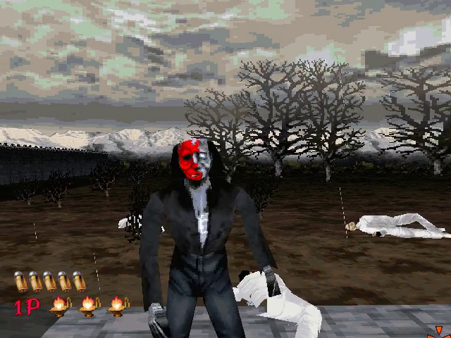
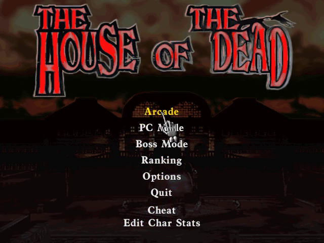

# The House of the Dead — static recompilation

Static recompilation of SEGA's **The House of the Dead** for Windows (1998) from
its shipping Win32 binary, `thotd.exe` (Watcom C, PE stamp 0x354411D6), to native
C, built on [pcrecomp](https://github.com/sp00nznet/pcrecomp)'s `native32` host.
It runs SEGA's own code, recompiled; it is not a remake and not an emulator.

**Generated source is not distributed.** You supply your own copy of the game,
and the lifted C is generated on your machine. Nothing from the game is in this
repository.



## Status: early alpha. The attract demo, the menus and Arcade mode play.

| Stage | State |
|---|---|
| Catalog (`disasm32`) | 11,530 functions; about 250 KB of zeroed tables in the code section are skipped ([pcrecomp#129](https://github.com/sp00nznet/pcrecomp/pull/129)) |
| Lift (`run_lift.py --all`) | 11,708 functions, 1.7M lines of C, 0 errors |
| Boot | Watcom start-up, the CD check, DirectInput, DirectDraw 8-bit 640x480, in a window |
| Attract | SEGA logo, title, the in-engine intro, the demo, at about 50 fps |
| Menus | main menu, by mouse |
| Arcade mode | chapter 1 plays: zombies, shooting, the HUD, Continue |
| Cheats (F10) | the game's own cheat mode and Creature Test, held on from the menu |
| Light gun | no gun: Sega's `gamebios.dll` is answered "none found"; the mouse aims |
| Sound | DirectSound; runs are muted unless `--sound`; not yet checked by ear |
| Played by hand, start to finish | not yet |

## Getting started

**The easy way:** the installer from the [latest release](https://github.com/sp00nznet/hotd-recomp/releases)
(or the newest [installer run](https://github.com/sp00nznet/hotd-recomp/actions/workflows/installer.yml)).
It's [recomp-launcher](https://github.com/sp00nznet/recomp-launcher): point it at
your game folder, press **Build**, then **Play**.

**By hand:** you need Windows 10/11 and your copy of the game: the folder it's
installed in (the one with `thotd.exe` and `art\`), or a .zip of that folder.
Clone this repo and [pcrecomp](https://github.com/sp00nznet/pcrecomp) side by side,
then double-click `Setup.cmd`:

```
hotd-recomp\     <- this repo
pcrecomp\        <- git clone https://github.com/sp00nznet/pcrecomp
```

Setup installs Python and the Visual Studio Build Tools if they're missing (it
asks first), copies the game into `game\`, catalogs and lifts `thotd.exe`,
builds `build\hotd.exe`, and leaves **The House of the Dead.cmd** to play. Run it
again after a failure and it carries on where it stopped.

Step by step, the same thing:

```
copy the game folder into game\, and game\thotd.exe into work\
py -3 ..\pcrecomp\tools\disasm\disasm32.py work\thotd.exe -o work\functions.json
py -3 run_lift.py --all
build.cmd
build\hotd.exe --run
```

## Playing

The mouse aims and the left button fires; the game's Options set up a second
player (Keyboard, Joystick) for two players on one PC.

**F10** opens the menu:

- *Cheats*, the game's own, held on for you (`hotd.ini` beside `hotd.exe`
  remembers them):
  - **Cheat mode** (the `SKIDMARX` code): invulnerable, no reloading, a
    **Cheat** item on the main menu (stage and scene select, free play) and
    **Edit Char Stats**. While it's on, Ctrl+R is rapid fire and Ctrl+1/Ctrl+2
    toggle player 1's/2's invulnerability. The developers' frame counter shows.
  - **Creature Test** (the `CREATURE` code): a model viewer on the main menu.



## What it took

Beyond the shared pipeline:

- **The task scheduler runs on setjmp/longjmp** (`sub_0043E354`): every task
  `longjmp`s back to it. Each call to the guest `setjmp` gets a landing pad, and
  the guest `longjmp` is patched to resume it from the host (`hotd_longjmp`,
  [pcrecomp#130](https://github.com/sp00nznet/pcrecomp/pull/130)).
- **The one-instance check is a global atom**, which outlives a crashed run and
  made every later run quit at once. The host keeps atoms per process.
- **The CD check** wants a CD-ROM drive without `thotd.exe` in its root; the
  virtual CD (the game folder) answers that it has none.
- **DirectInput** wants a real HINSTANCE, and a headless run reads it in the
  background so it sees only scripted input.
- **Data in the code section**: 256 records after the last function chain into
  each other as code; `run_lift.py` skips them (`DATA_IN_CODE`).

## Testing

`--headless --record out.mp4 --watchdog 60` runs off-screen. `--pad FILE` is an
input mailbox: `0x20 400` holds Space for 400 ms, `m 318 220` moves the cursor to
a point of the 640x480 picture, `0x01` clicks. `tools\drive.ps1` plays a timeline
of those (`tools\scripts\arcade.txt` starts Arcade mode), and `--cmd cheat@1`
runs an F10 command at a time. A function the catalog missed shows up as
`ICALL: unresolved VA`; `py -3 tools\seed_from_log.py run.log` seeds it for the
next lift.

## License

MIT for what's ours (the host, tools and docs); see [LICENSE](LICENSE). The House
of the Dead is SEGA's.
